# Castlevania Belmont’s Curse para macOS

[](https://github.com/SwonDev/cstlvnia-blmont-to-macos/actions/workflows/docs.yml)

**Tu propia copia de Castlevania: Belmont’s Curse, convertida en una app local para Apple silicon.** Este proyecto reúne las fuentes, las adaptaciones y el proceso utilizado para instalar y jugar en Mac: interfaz original en español, cinemáticas, audio, salida Retina y mando Switch 2 Pro mediante Switch2Bridge.

**Apple silicon · Contenido 1.1.0 · App 1.1.4 · Código MIT · Aporta tus archivos del juego**

[Compilar e instalar](#compilar-e-instalar) · [Pantalla y resolución](#pantalla-y-resolución) · [Mando](#mando-switch-2-pro) · [Cómo se consiguió](#cómo-se-consiguió) · [Galería](docs/GALERIA.md) · [Metodología completa](docs/METODOLOGIA.md)

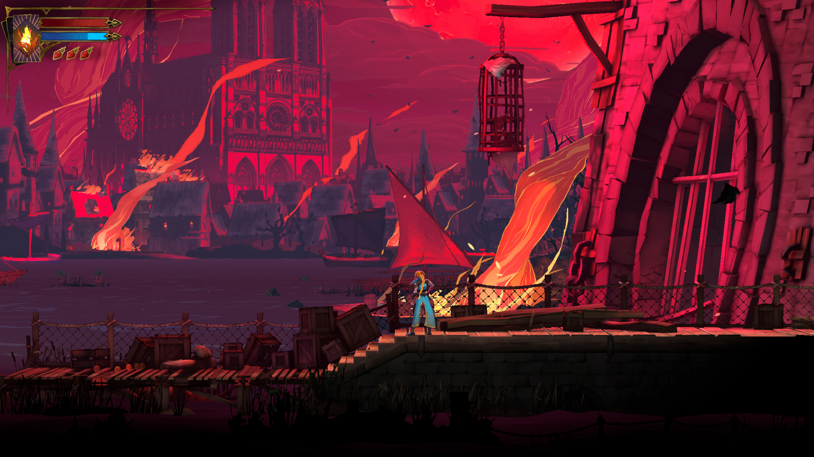

| Cinemáticas y subtítulos | Diálogos e interfaz originales |
|:---:|:---:|
| 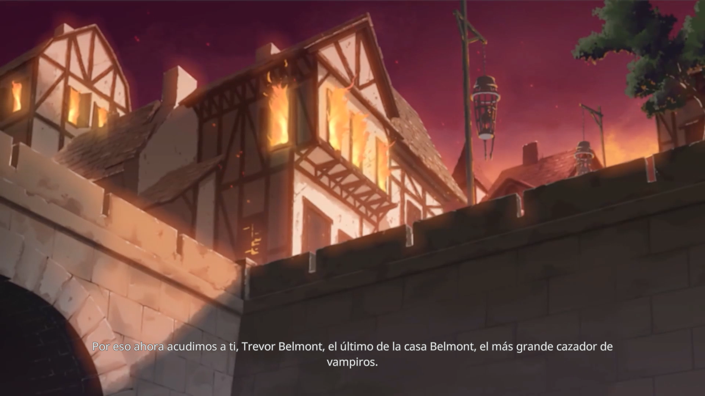 | 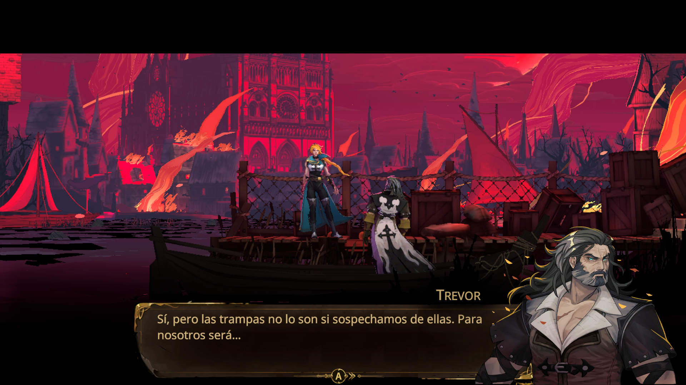 |

Las imágenes son lecturas GPU de las pruebas locales. La [galería](docs/GALERIA.md) identifica qué versión produjo cada una; las capturas históricas ilustran el recorrido y no sustituyen la validación de la candidata actual.

## La experiencia en Mac

El resultado es un bundle `.app` con icono, recursos y dependencias internas. Se abre desde Finder y conserva el lenguaje visual del juego: menús, HUD, diálogos, arcanos, equipamiento y opciones originales. Sus datos modificables se guardan fuera del bundle.

| Área | Adaptación incluida |
|---|---|
| Juego | Programa AArch64 recompilado a C++ y ejecutable nativo arm64; servicios del sistema proporcionados por el runtime. |
| Gráficos | NVN sobre Vulkan/MoltenVK; shaders traducidos localmente desde tus archivos. |
| Cinemáticas y sonido | Decodificación, presentación y audio del juego; correcciones de formato, sincronización y ABI documentadas. |
| Vídeo | Resolución seleccionable, ventana, maximización y pantalla completa de escritorio. |
| Entrada | Cliente Switch2Bridge y teclado del runtime; conserva glifos y disposición Nintendo. |
| Instalación | Paquete autónomo, firma ad hoc e instalación nueva en una carpeta de aplicaciones libre. |

| Equipamiento | Arcanos |
|:---:|:---:|
| 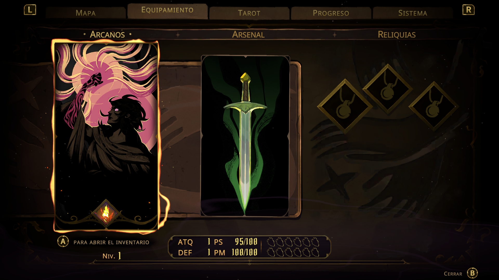 | 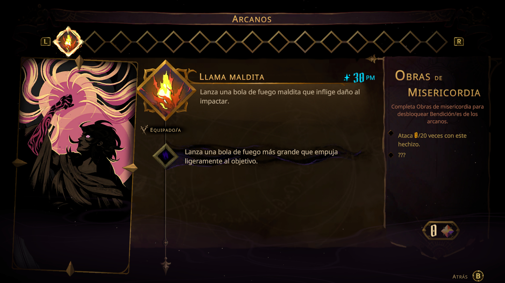 |

## Pantalla y resolución

El menú original **Vídeo** permite seleccionar resolución y modo de ventana, aplicar o descartar cambios. La salida nativa mantiene la proporción 16:9: un panel de 3024 × 1964 usa un lienzo de **3024 × 1701**. Los píxeles renderizados y los puntos de la ventana son medidas distintas.

| Resolución nativa ajustada a 16:9 | Pantalla completa de escritorio |
|:---:|:---:|
| 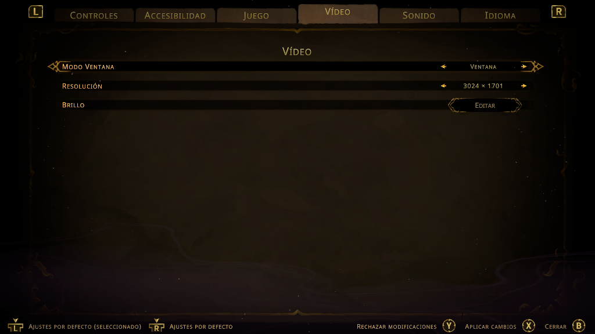 | 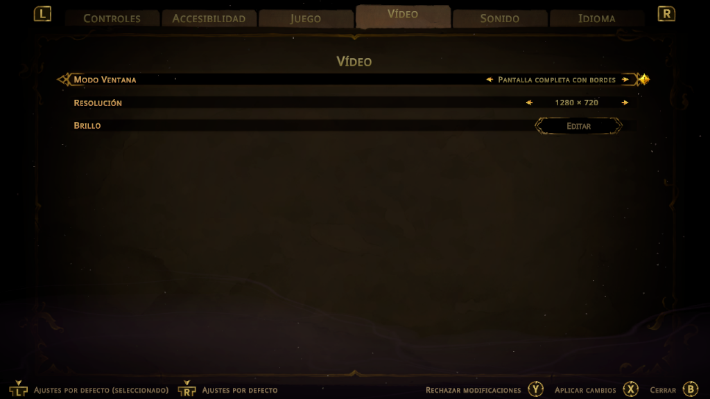 |

SDL/AppKit gestiona ventana, maximización y pantalla completa. El modo exclusivo de Windows se adapta al modo de escritorio de macOS. El menú **Vídeo** de la barra de menús muestra además la salida en píxeles. Las películas conservan el detalle de su resolución de origen.

## Mando Switch 2 Pro

La integración utiliza **[SwonDev/Switch2Bridge](https://github.com/SwonDev/Switch2Bridge)**, el proyecto del puente que ya existe, y su consumidor nativo en este runtime.

1. Instala y configura el puente siguiendo su README.
2. Conecta el mando y comprueba que el puente recibe eventos.
3. Abre el juego: el cliente consume sus tramas y conserva los botones y glifos Nintendo.

Este perfil usa Switch2Bridge y teclado; el mando SDL genérico no es una alternativa habilitada. El consumidor no instala un dispositivo virtual global ni requiere desactivar SIP. La vibración y la cobertura completa de botones físicos están pendientes. [Configuración, protocolo y alcance de las pruebas](docs/SWITCH2BRIDGE.md).

## Compilar e instalar

### 1. Preparar el Mac

Necesitas Apple silicon, Xcode con SDK de macOS, Python 3.12 o posterior, CMake, Ninja y SDK .NET 10. Con Homebrew ya instalado:

```sh
xcode-select --install
brew install python@3.12 cmake ninja sdl3 molten-vk vulkan-headers vulkan-loader spirv-tools dotnet

git clone https://github.com/SwonDev/cstlvnia-blmont-to-macos.git
cd cstlvnia-blmont-to-macos
./build-macos.sh --doctor
./build-macos.sh --stage test --jobs 4
```

Los contratos comprueban el host antes de generar los archivos grandes. El mínimo de la app se calcula al empaquetar a partir del ejecutable, SDL3 y MoltenVK: en la construcción local verificada es **macOS 27**. Una prueba de contratos en otro sistema no acredita por sí sola que el juego completo funcione allí.

### 2. Aportar tu copia 1.1.0

| Argumento | Entrada local |
|---|---|
| `--exefs` | Directorio descifrado con `main`, `sdk` y `subsdk0` de la revisión 1.1.0. |
| `--romfs` | Raíz de RomFS, con `Data/` dentro; no apuntar directamente a esa subcarpeta. |
| `--icon` | Imagen del icono de Control/NACP de tu copia; se convierte localmente a `.icns`. |

Los [build ID y hashes admitidos](games/castlevania/build.json) se comprueban antes del AOT. RomFS debe corresponder a esa misma revisión: se contrasta su raíz y el conjunto requerido de shaders, no todos sus recursos. El repositorio no obtiene ni descifra el juego.

### 3. Construir la app

```sh
./build-macos.sh \
  --exefs "/ruta/a/tu/ExeFS" \
  --romfs "/ruta/a/tu/RomFS" \
  --icon "/ruta/a/tu/icono-Control.dat" \
  --language es \
  --jobs 4 \
  --stage all \
  --install
```

La salida instalada es **`~/Applications/Castlevania Belmont’s Curse.app`**. Ábrela desde Finder. Sin `--install`, queda en `private/dist/`. El instalador exige un destino nuevo y conserva las instalaciones y partidas existentes.

El pipeline prepara entradas → genera AOT → traduce shaders → compila → ejecuta pruebas → empaqueta y firma. El C++ generado, objetos y recursos ocupan varios GB; empieza con cuatro trabajos paralelos. El entorno Python y el traductor se preparan en `private/`, con dependencias, revisión de fuentes y hashes fijados. [Procedencia y licencias](UPSTREAM.md).

<details>
<summary>Reanudar por etapas, elegir idioma y cambiar el destino</summary>

```sh
./build-macos.sh --stage prepare --exefs "/ruta/a/tu/ExeFS" --romfs "/ruta/a/tu/RomFS" --icon "/ruta/a/tu/icono-Control.dat"
./build-macos.sh --stage generate --jobs 4
./build-macos.sh --stage shaders --jobs 4
./build-macos.sh --stage build --jobs 4
./build-macos.sh --stage package --install-dir "$HOME/Applications"
```

| Etapa | Resultado |
|---|---|
| `prepare` | Valida revisión, extrae imágenes NSO y prepara el idioma y un enlace gestionado a RomFS. |
| `generate` | Genera C++ para los tres módulos, con excepciones y perfil del juego. |
| `shaders` | Descubre, traduce y valida programas de ExeFS/RomFS. |
| `build` | Reutiliza o genera AOT, compila y ejecuta CTest/Python; no traduce shaders. |
| `package` | Empaqueta ejecutable y recursos ya preparados en una app nueva. |
| `test` | Ejecuta los contratos y pruebas Python sin datos comerciales. |

Las rutas se guardan en `private/input.json`; conserva el RomFS disponible. `--language` admite `es`, `en` y `ja`, con `es` por defecto: repítelo al reanudar si elegiste otro idioma. No se añaden traducciones externas.

La caché de shaders y la salida de paquete deben ser nuevas. No repitas `all` o `package` sobre una candidata existente: reanuda la etapa necesaria y conserva la app anterior, o utiliza otro checkout. El empaquetador directo admite otro `--output` bajo `private/`.

Si ya ejecutaste `all` sin instalar, mueve la app terminada desde `private/dist/` con Finder a una carpeta de aplicaciones libre. `--install-dir` también solicita instalación y rechaza destinos simbólicos o una app ya existente. La firma es ad hoc local, sin notarización. Los datos modificables usan `SDL_GetPrefPath("SwonDev", "castlevania")`; no se importan partidas del workspace privado.

```sh
./build-macos.sh --help
python3.12 scripts/macos_bundle.py --help
```

</details>

## Cómo se consiguió

El objetivo fue reproducir el comportamiento del juego en una app macOS y guardar cada causa y comprobación para el siguiente proyecto. El [caso Castlevania](docs/CASO-CASTLEVANIA.md) detalla los recorridos; el [método completo](docs/METODOLOGIA.md) recoge las fases, experimentos, empaquetado, privacidad y limpieza.

| Frontera | Trabajo realizado |
|---|---|
| Programa y sistema | Identificar módulos y revisión; adaptar carga, inicializadores, importaciones, memoria, servicios e instrucciones. Mantener pruebas del comportamiento original. |
| Shaders y fondos | Descubrir recursos Unity también sin extensión; conservar metadatos, traducir variantes y validar el inventario requerido completo. |
| Audio y películas | Comprobar ABI, frecuencia, canales, muestras, planos y recorte; separar señal PCM medida de escucha real. |
| Transiciones | Localizar el primer fotograma divergente; corregir orden de copias y preparación del índice de animación antes de publicar el material. |
| Vídeo y entrada | Exponer los selectores originales, respetar aplicar/descartar y persistencia; integrar el cliente real Switch2Bridge con pruebas aisladas. |
| App y reproducción | Firmar antes de probar, cargar recursos internos desde fuera del checkout, preservar partidas y construir de nuevo desde las fuentes públicas. |

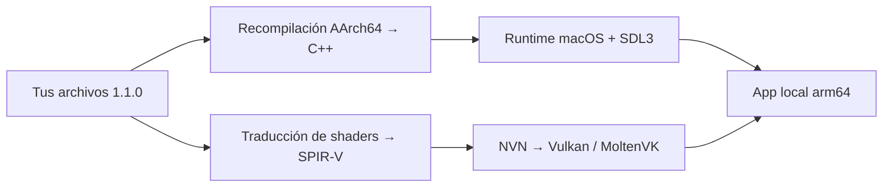

### Pruebas y alcance

El pipeline público se construyó desde entradas propias nuevas, sin reutilizar el AOT ni la caché comercial de la instalación previa. La [validación](docs/VALIDACION.md) identifica revisiones, ejecutables y recursos de cada candidata.

| Comprobación | Evidencia |
|---|---|
| Contratos locales | 33 CTest; suite de 72 pruebas Python, una nativa opcional omitida en esa ejecución. |
| Instrucciones | 58 formas y 9.744 estados contrastados con Unicorn. |
| Shaders | 5.000 inventariados, 4.999 SPIR-V válidos y los 4.774 requeridos completos. |
| Empaquetado | 22 pruebas, incluida firma y carga relocalizada de SDL3/MoltenVK con herramientas reales. |
| Recorrido | Partida, HUD, menú de vídeo, cambios de resolución, audio PCM y recarga en perfiles QA separados. |
| GitHub | [macOS 26 M1 y Linux pasan](https://github.com/SwonDev/cstlvnia-blmont-to-macos/actions/runs/39158560322); en Mac, 33 CTest y 72 pruebas Python, incluido empaquetado nativo. |

Las pruebas de GitHub ejecutan contratos sin el juego. Su estado real está en la insignia superior y los detalles de cada ejecución. El diagnóstico de memoria del runner M1 y la validación de su corrección se registran en [VALIDACION](docs/VALIDACION.md).

Quedan un programa geometry y tres instrucciones AOT estáticas sin soporte completo. Las pruebas finitas no recorren todos los niveles ni acreditan escucha por altavoces, vibración o todos los botones físicos. No se publica una app binaria: el usuario la construye con sus propios archivos.

<details>
<summary>Más capturas: menú, opciones, prólogo y cinemáticas</summary>

| Menú | Opciones de la construcción pública |
|:---:|:---:|
| 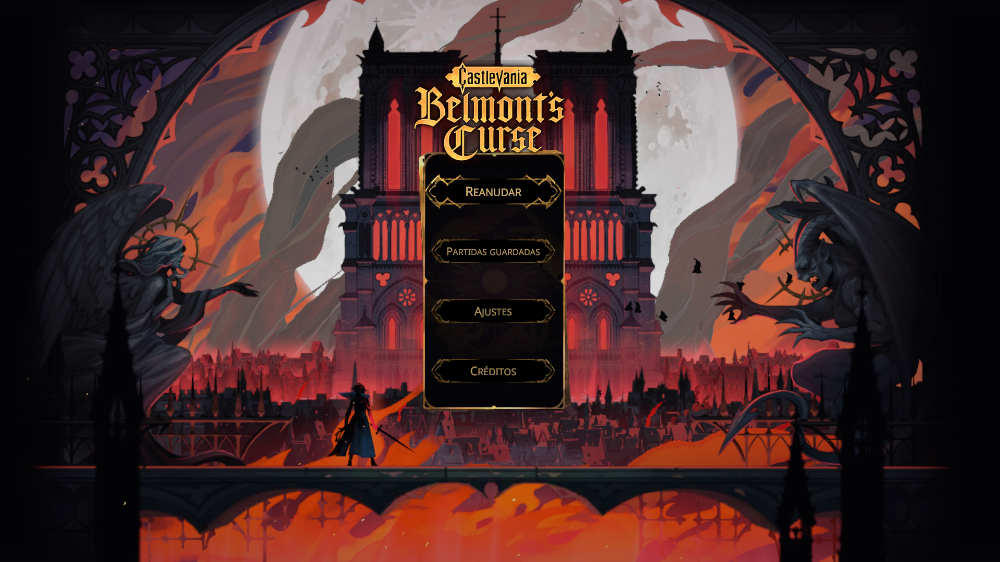 | 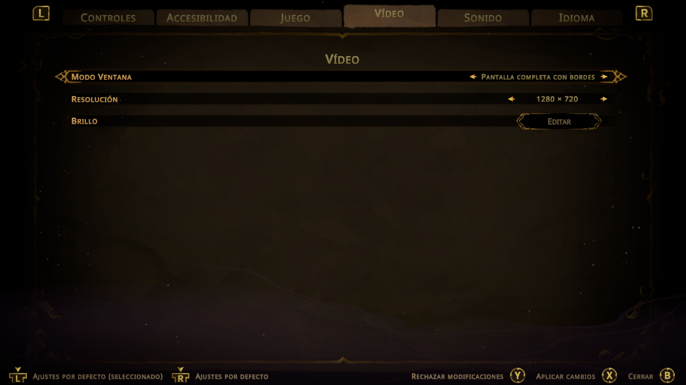 |

| Trevor | Escenario |
|:---:|:---:|
| 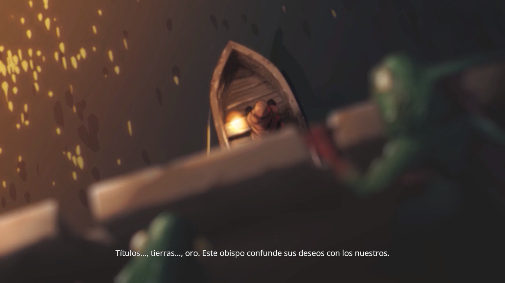 | 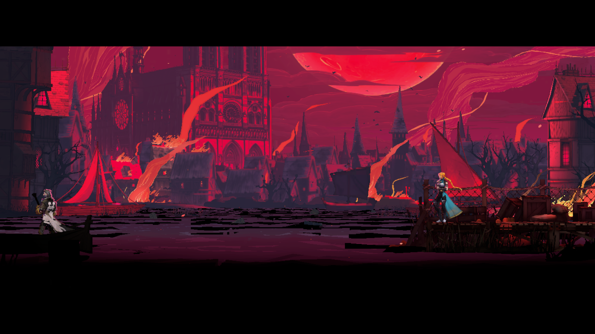 |

| Partida | Tutorial |
|:---:|:---:|
| 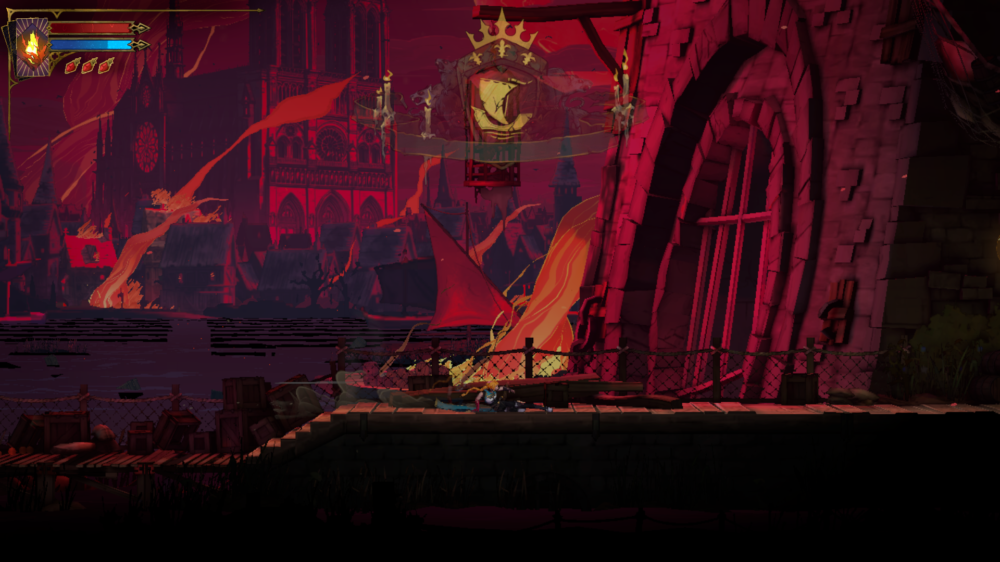 | 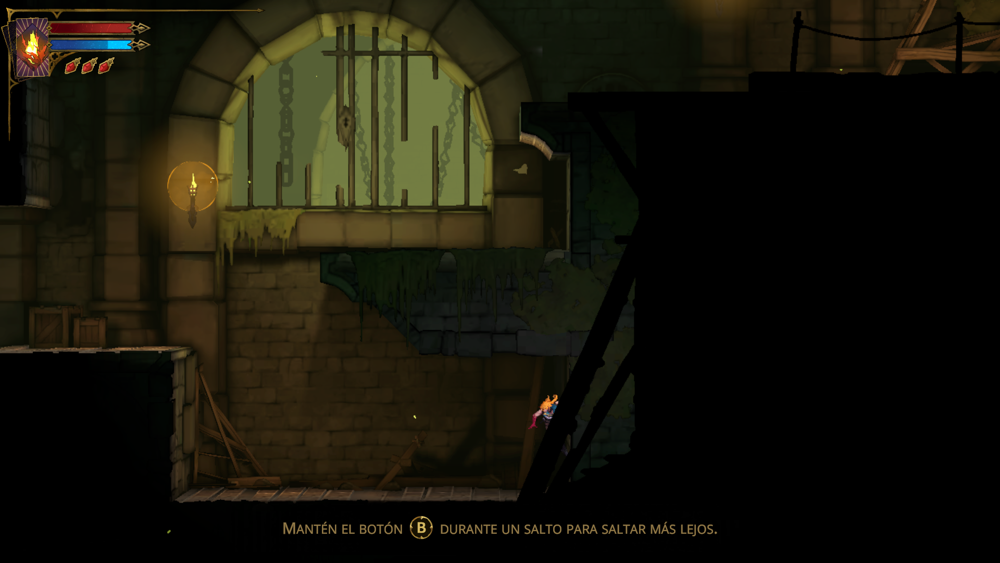 |

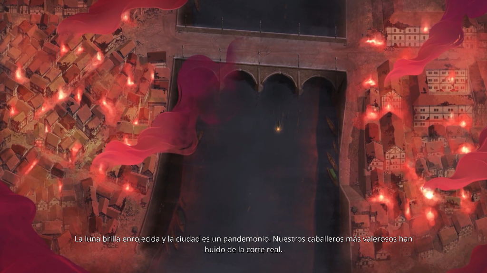

[Galería completa con contexto, dimensiones y procedencia](docs/GALERIA.md).

</details>

## Documentación y contribuciones

| Documento | Para qué sirve |
|---|---|
| [Metodología](docs/METODOLOGIA.md) | Repetir el proceso en otros proyectos y registrar las causas. |
| [Caso Castlevania](docs/CASO-CASTLEVANIA.md) | Entender las adaptaciones y los recorridos de este juego. |
| [Validación](docs/VALIDACION.md) | Contrastar resultados e identidades de las apps probadas. |
| [Switch2Bridge](docs/SWITCH2BRIDGE.md) | Configurar y entender la entrada del mando. |
| [Procedencia](UPSTREAM.md) y [créditos](CREDITS.md) | Consultar autores, revisiones y licencias. |
| [Contribuir](CONTRIBUTING.md) | Proponer mejoras con pruebas y sin adjuntar material privado. |
| [Entrega y privacidad](docs/ENTREGA-Y-PRIVACIDAD.md) | Revisar qué puede formar parte del repositorio. |

## Créditos y licencia

La base del runtime es **[SuperMarioWonderRecomp](https://github.com/BelmanteGu/SuperMarioWonderRecomp)**, de BelmanteGu y contribuidores. El traductor utiliza una revisión fijada de **Ryubing**. **[D2R Mobile](https://github.com/jhaizhou-ops/d2r-mobile)**, de jhaizhou-ops y contribuidores, es el antecedente de la metodología y la referencia de presentación; su [PR #87](https://github.com/jhaizhou-ops/d2r-mobile/pull/87) acredita el trabajo relacionado. La entrada del mando integra **[Switch2Bridge](https://github.com/SwonDev/Switch2Bridge)**. Las revisiones y avisos de terceros están en [UPSTREAM.md](UPSTREAM.md).

Código original del proyecto y modificaciones bajo [MIT](LICENSE). **Castlevania: Belmont’s Curse**, su contenido, imágenes y marcas pertenecen a KONAMI y a los demás titulares identificados por el juego. Las capturas documentales están excluidas de MIT. Proyecto independiente, sin afiliación ni aprobación de KONAMI, Nintendo o Apple.

No se publican ROM, claves, firmware, partidas, AOT, SPIR-V derivados del juego ni paquetes de recursos. Las entradas, artefactos y logs se quedan en `private/`. Una app construida con tu copia contiene recursos del juego: no la adjuntes a releases, issues o PR.
